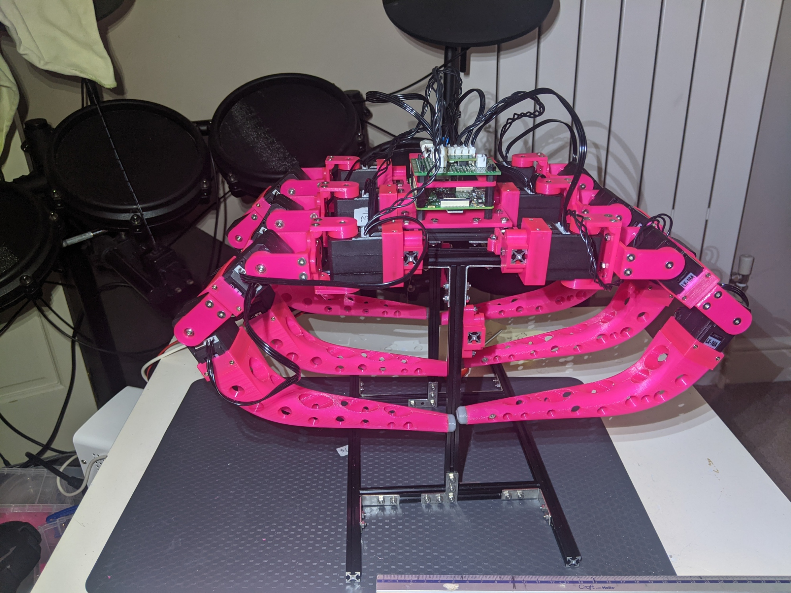
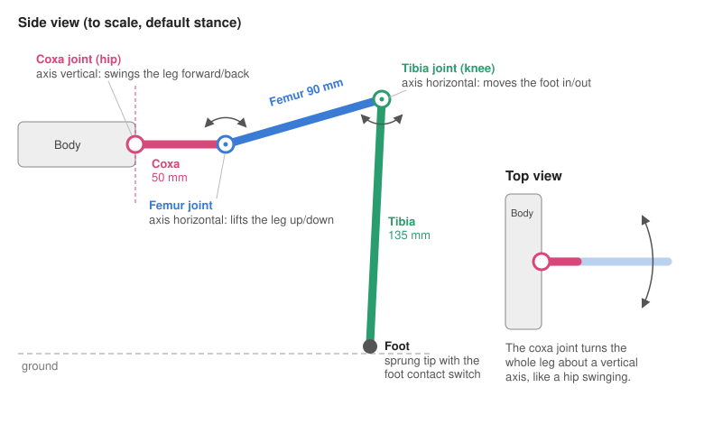

# Hexapotamaus

A pink six-legged robot. The 2021 version ran inverse kinematics in Python on a Raspberry Pi; that code is kept at the git tag `v1-python`.

The rebuild starts with a single leg on a calibration rig: a leg controller (XIAO ESP32-C6) per leg on a CAN bus, driven by a TypeScript brain, with a simulated leg that speaks the same protocol. See the [single-leg milestone spec](.scratch/single-leg/spec.md).



## Leg parts

Each leg has three segments and three joints, one LX-16A servo per joint. The names match [CONTEXT.md](CONTEXT.md).



| Part | What it does |
|---|---|
| **Coxa joint** (hip) | Vertical axis: swings the whole leg forward and back |
| **Coxa** (50 mm) | The short link from the body to the femur joint |
| **Femur joint** | Horizontal axis: lifts the leg up and down |
| **Femur** (90 mm) | The thigh, from the femur joint to the tibia joint |
| **Tibia joint** (knee) | Horizontal axis: moves the foot in and out |
| **Tibia** (135 mm) | The shin, from the knee to the foot |
| **Foot** | The sprung tip that touches the ground, with the foot contact switch |

## Workspace layout

A pnpm workspace on Node 24 LTS (see `.nvmrc`), TypeScript and Vitest.

| Package | What it holds |
|---|---|
| `packages/protocol` | CAN message definitions and encode/decode, shared by the brain, the simulated leg and the viewer |
| `packages/kinematics` | Leg geometry, forward and inverse kinematics, reachability. Pure functions |
| `packages/brain` | The controller: frame transport, control loop, leg sessions, calibration, the viewer feed |
| `packages/sim` | The simulated leg on a virtual CAN bus, with simulated switches and injected errors |
| `packages/conformance` | The protocol conformance suite: drives a leg only through CAN frames, so the same tests run against the simulated leg and the real one |
| `packages/socketcan` | The SocketCAN frame transport, for the brain and the simulated leg on `vcan0` or `can0`, through a small Python bridge ([ADR 0006](docs/adr/0006-socketcan-through-a-python-bridge.md)) |
| `packages/dashboard` | The leg viewer: a Vite, React and Tailwind app that draws the leg live with three.js, fed by the brain ([docs/viewer.md](docs/viewer.md)) |

The brain and the leg controllers talk over CAN using the [leg CAN protocol](docs/protocol.md). Joint angles follow the [kinematics conventions](docs/kinematics.md); the leg geometry is configuration, in [config/leg-geometry.json](config/leg-geometry.json).

Packages are TypeScript source with no build step: Vitest runs them directly, and Node 24 runs `.ts` files natively. The dashboard is the exception: Vite serves it (`pnpm dashboard`).

## Running the tests

```sh
pnpm verify      # install, type-check every package, run every test
pnpm test        # tests only (or `pnpm test --watch`)
pnpm typecheck   # type-check only
```

The tests that run the brain and the simulated leg as separate processes on a virtual CAN bus need `vcan0` and `python3`. Without `vcan0` they are skipped, with a message saying so. To set up `vcan0` on WSL, watch it with `candump`, and run the brain and the simulated leg by hand (`pnpm sim`, `pnpm brain`), see [docs/vcan.md](docs/vcan.md).

## Bus servo
The servos used in this robot:

https://www.hiwonder.com/store/learn/26.html
https://drive.google.com/drive/folders/1Hyk9LERYsAV_pSeEv5jMgaLblkSN4Xpn

## Vendor files (not in git)

The manufacturer's LX-16A download (manuals, protocol PDFs, Arduino/STM32/51 sample code, Windows tools)
and the CH341 USB-serial driver (`ch341ser.exe`, for the servo debug board) are no longer tracked in git.
They live in `vendor-archive/` locally (gitignored) and are archived at:

**Archive location:** `C:\Users\phils\OneDrive\2026\making\vendor-archive` (the owner's OneDrive)

The key documents to keep handy are the _LX-16A Serial Bus Servo User Manual_ and the
_Hiwonder Bus Servo Communication Protocol_ PDFs. The Python servo library the 2021 version used
(from [maximkulkin/lewansoul-lx16a](https://github.com/maximkulkin/lewansoul-lx16a)) is at `packages/robot/LewanSoul/` in the tag `v1-python`.

Note: these files are still in older git history, so a fresh clone is about 113 MB. That was a deliberate choice: the history was already public.

## Useful links
[examples](https://www.instructables.com/How-to-Configure-and-Use-Smart-Servos-LewanSoul-LX/)
https://www.youtube.com/watch?v=M71dl8aHCI0&list=PLQYW5Ukp-1D-amIge4qTAPyu934yNjoPy&ab_channel=HiwonderRobot

[algebra  ](https://www.mathsisfun.com/algebra/trig-solving-sss-triangles.html)  

[motor](https://www.hiwonder.hk/collections/servo/products/hiwonder-lx-16a-full-metal-gear-serial-bus-servo)

[connector](https://www.molex.com/molex/products/family/minispox)

[LX-16A bracket set, with dimension drawings](https://www.hiwonder.com/products/servo-bracket-compatible-with-lx-16a) (summarised in [lx-16a-dimensions.md](docs/hardware/lx-16a-dimensions.md))

## Licence

MIT. See [LICENSE](LICENSE). This covers the code, CAD and documentation.

Exception: `packages/robot/LewanSoul/` in the tag `v1-python` is third-party code under GPLv3 and keeps that licence. It is not part of the current code.
